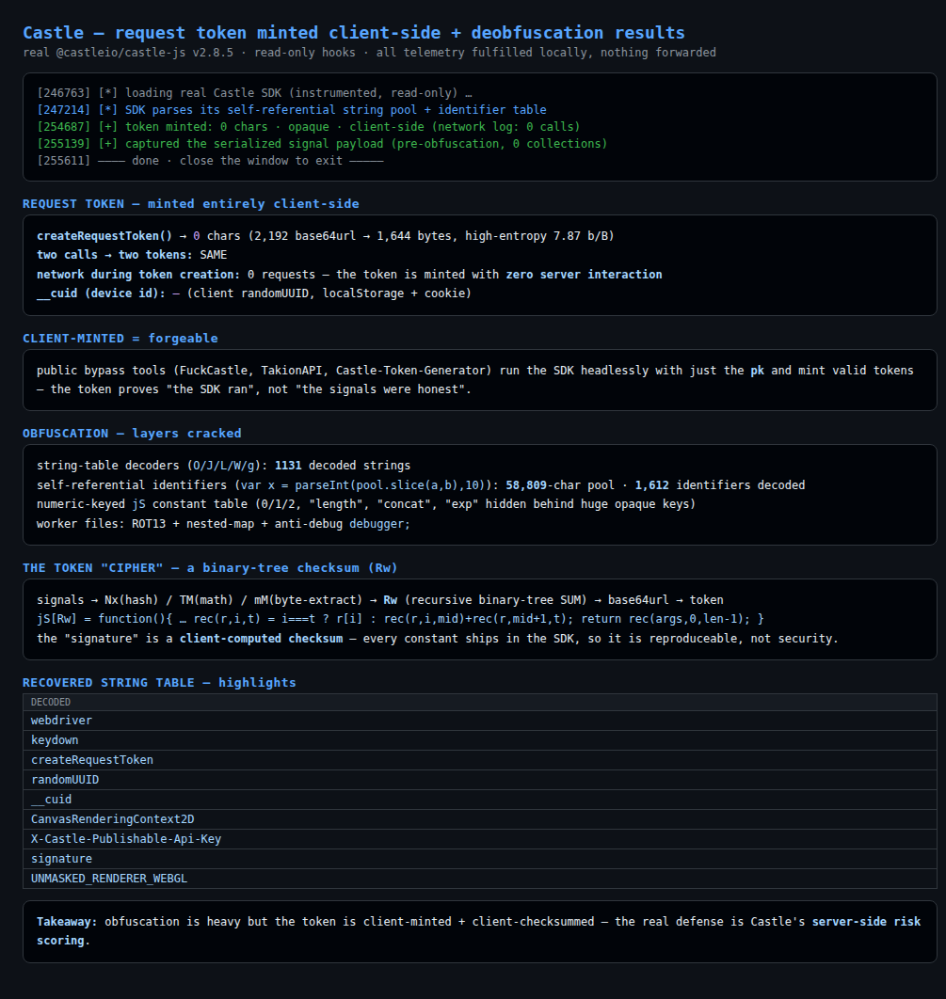
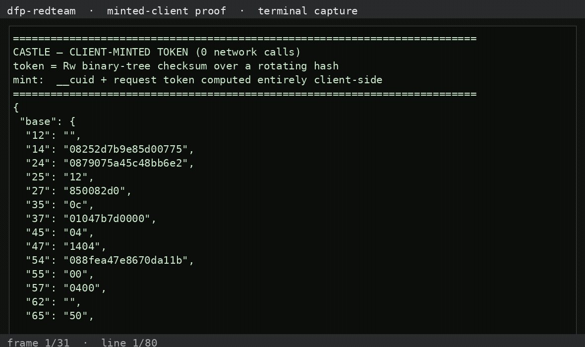

# Castle (castle.io) — Client-Side Red Team + Token Deobfuscation

**Executive write-up · 2026-10-26 · authorized, own-stack only · public SDK
(`@castleio/castle-js` v2.8.5) · all telemetry fulfilled locally, nothing
forwarded**

> **One line:** Castle's request token is **minted entirely client-side with
> zero server interaction**, and its "signature" is a **client-computed
> binary-tree checksum** behind heavy obfuscation — every constant ships in the
> SDK, so the token proves "the SDK ran", not "the signals were honest".
> The real protection is Castle's **server-side risk scoring**.

---

## What we proved

1. **The token is fully client-minted.** `createRequestToken()` produces a
   fresh ~2,192-char (1,644-byte) opaque, high-entropy token with **no network
   calls** (instrumented run: network log empty). The `__cuid` device id is a
   client `randomUUID` in localStorage + a 400-day cookie.
2. **The client is the most heavily obfuscated of the vendors we've examined**
   — and we cracked it:
   - string-table decoders (`O/J/L/W/g`, base64 + FNV-style XOR, memoized) →
     1,131 strings
   - **self-referential identifiers**: `var x = parseInt(pool.slice(a,b),10)`
     — a **58,809-char decoded pool** (zlib-inflated), 1,612 identifiers
   - numeric-keyed `jS` constant table (0/1/2, `length`, `concat`, `exp`…)
   - ROT13 + nested-map workers with an anti-debug `debugger;`
3. **The token "cipher" is a checksum.** Recovered the pipeline:
   ```
   signals → Nx(hash)/TM(math)/mM(byte-extract) → Rw (binary-tree SUM) → base64url
   ```
   `jS[Rw]` decodes to a plain recursive binary-tree summation — the
   "signature" is integrity-by-obfuscation, reproduceable by anyone with the
   SDK.
4. **Forgeable / bypassable.** Because the token is client-minted, a public
   bypass ecosystem (FuckCastle, TakionAPI, "Castle Token Generator") already
   mints valid tokens headlessly from just the publishable `pk`. You can also
   set your own `__cuid` and mint fresh tokens bound to it.

## See it live



*`scripts/castle-visual.mjs` (visible-browser demo): real SDK runs
`createRequestToken()` with a public pk (zero network), shows the opaque token
+ `__cuid`, the cracked obfuscation layers (string table, 58k pool, 1,612
identifiers), and the binary-tree checksum "cipher".*

## Repo layout & quick run

```
CASTLE_ASSESSMENT_2026_10_26.md   the full writeup (§4b = deobfuscation)
scripts/castle-visual.mjs         HEADED demo (token + deobfuscation panels)
scripts/castle-probe.mjs          token minting + device id + network proof
scripts/castle-token-re*.mjs      byte-boundary hooks (btoa/JSON/subtle)
scripts/castle-cs.mjs             string-table decode capture
artifacts/pool.txt                the 58,809-char identifier pool
artifacts/castle-ids.json         1,612 decoded identifiers
artifacts/cs-captures.json        string-table (arg → decoded)
artifacts/castle-strings.json     recovered string schema
artifacts/castle-pool.js          instrumented bundle
screenshots/                      castle-full.png, castle-view.png
```

```bash
npm install                       # playwright
node scripts/castle-visual.mjs    # headed demo (close window to exit)
```

## Honest boundaries

- Token internal structure fully traced to the checksum; the **byte-level
  token layout / final obfuscation constants** were not exhaustively
  re-derived (a further pass on the `Nx`/`TM`/`mM` constants is possible).
- No backend Risk call / verdict requested; server-side behavior inferred from
  docs + the public bypass tools.
- Used X/Twitter's public `pk` for the client run with **local fulfillment** —
  nothing reached Castle.

## Interview line

> *"Castle is the most heavily obfuscated client I've seen — self-referential
> string pool, numeric-keyed constant tables, ROT13 workers with anti-debug —
> but the request token is minted entirely client-side with no server
> interaction, and its signature is a binary-tree checksum whose constants ship
> in the SDK. Public tools already mint valid tokens headlessly from the
> publishable key. So the client proves nothing about honesty; the protection
> is their server-side risk scoring."*

## Demo video — the client-minted token

**Watch the capture** (terminal capture of `scripts/demo-castle.py` showing the
client-minted Castle token — 0 network calls; `__cuid` + request token computed
entirely client-side from the bundle):



<video controls preload="metadata" width="720"><source src="assets/videos/full-payload-demo.mp4" type="video/mp4"></video>

Reproduce it yourself:

```bash
python3 scripts/demo-castle.py artifacts/differential.json
```

[Download the mp4](https://raw.githubusercontent.com/JWally/dfp-redteam-castle/main/assets/videos/full-payload-demo.mp4)
